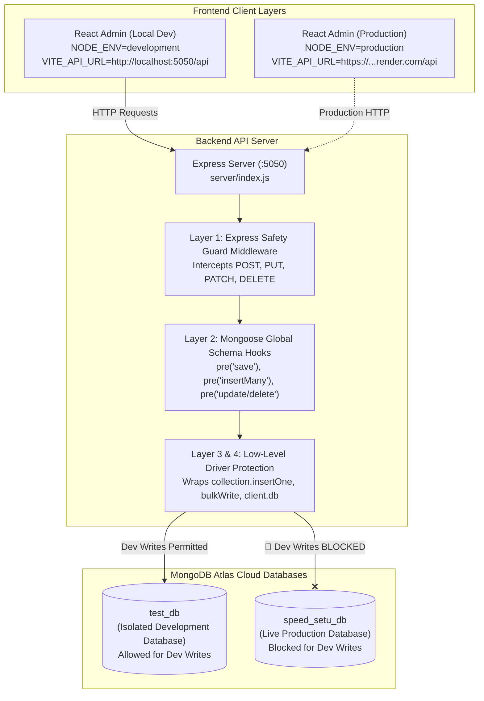

# 🛡️ MongoDB Database Isolation & Security Hardening Documentation

This document provides a complete explanation of all changes implemented to achieve 100% development and production isolation for the **Speed Setu** ecosystem, safely clone the live database into `test_db`, and prevent data leakage between environments.

---

## 📋 Table of Contents
1. [Overview & Objective](#-overview--objective)
2. [Root Cause Analysis](#-root-cause-analysis)
3. [Database Cloning Summary](#-database-cloning-summary)
4. [Architecture & Request Flow](#-architecture--request-flow)
5. [File-by-File Detailed Changes](#-file-by-file-detailed-changes)
6. [Multi-Tier Write Protection Layers](#-multi-tier-write-protection-layers)
7. [Atlas Disconnection Fixes](#-atlas-disconnection-fixes)
8. [Verification & Test Results](#-verification--test-results)
9. [Developer Guide & Best Practices](#-developer-guide--best-practices)

---

## 🎯 Overview & Objective

Prior to these changes, local development actions occasionally affected the live production database `speed_setu_db`. The goals of this intervention were:
1. **Preserve Production Data:** Treat `speed_setu_db` as strictly read-only and leave all live customer records untouched.
2. **Complete Structural Clone:** Replicate all 13 collections, 355 documents, and 27 indexes into a new isolated `test_db`.
3. **Eliminate All Silent Fallbacks:** Ensure development cannot silently connect or send writes to production under any circumstance.
4. **Implement Multi-Tier Write Guards:** Enforce write safety at the HTTP middleware, Mongoose schema, low-level driver, and MongoClient levels.

---

## 🔍 Root Cause Analysis

During investigation, three major security vulnerabilities were identified:

### 1. React Admin Client Silent Production Fallback
In `admin/src/services/apiClient.js`:
```javascript
// BEFORE:
export const BASE_URL = import.meta.env.VITE_API_URL || 'https://speed-setu-final.onrender.com/api';
```
- The `admin/` directory lacked an `.env` file for local development.
- When developers ran `npm run dev` in `admin/`, `VITE_API_URL` evaluated to `undefined`.
- **Result:** Every form submission, shipment creation, or user update in the local admin UI sent live HTTP write requests to the **Render production deployment**, directly modifying `speed_setu_db`.

### 2. Lack of Centralized Backend Environment Routing
In `server/.env` and `server/config/db.js`:
- `MONGO_URI` directly targeted `speed_setu_db` with no conditional environment switching or validation based on `NODE_ENV`.
- Running `node index.js` or backend scripts locally connected directly to the production database cluster.

### 3. Absence of Database Write Guards
- Any service or script connecting with a production connection string could freely execute `save()`, `updateOne()`, `deleteMany()`, or `dropDatabase()`.

---

## 📦 Database Cloning Summary

The production database `speed_setu_db` was cloned into `test_db` on MongoDB Atlas using BSON binary serialization to guarantee byte-for-byte fidelity:

| Collection | Source Docs | Cloned Docs | Indexes Recreated | Match Status |
| :--- | :---: | :---: | :---: | :---: |
| `companies` | 12 | 12 | 2 (`_id_`, `companyId_1` [unique]) | ✅ MATCH |
| `counters` | 1 | 1 | 1 (`_id_`) | ✅ MATCH |
| `drivers` | 0 | 0 | 2 (`_id_`, `driverId_1` [unique]) | ✅ MATCH |
| `expenses` | 4 | 4 | 2 (`_id_`, `expenseId_1` [unique]) | ✅ MATCH |
| `invoices` | 39 | 39 | 2 (`_id_`, `invoiceNumber_1` [unique]) | ✅ MATCH |
| `payables` | 0 | 0 | 3 (`_id_`, `payableNumber_1`, `payableId_1`) | ✅ MATCH |
| `payments` | 0 | 0 | 2 (`_id_`, `paymentNumber_1` [unique]) | ✅ MATCH |
| `quotations` | 12 | 12 | 2 (`_id_`, `quotationNumber_1` [unique]) | ✅ MATCH |
| `shipments` | 282 | 282 | 2 (`_id_`, `cnNumber_1` [unique]) | ✅ MATCH |
| `transporters` | 0 | 0 | 2 (`_id_`, `transporterId_1` [unique]) | ✅ MATCH |
| `trips` | 0 | 0 | 2 (`_id_`, `tripNumber_1` [unique]) | ✅ MATCH |
| `users` | 5 | 5 | 3 (`_id_`, `username_1`, `email_1` [unique]) | ✅ MATCH |
| `vehicles` | 0 | 0 | 2 (`_id_`, `vehicleNumber_1` [unique]) | ✅ MATCH |
| **Total** | **355** | **355** | **27 Index Definitions** | **100% Identical** |

> **Production Integrity Check:** `speed_setu_db` was independently verified before and after cloning. Document counts remained identical (355 documents, 0 modifications).

---

## 🏗️ Architecture & Request Flow



---

## 📝 File-by-File Detailed Changes

### 1. `server/config/safetyGuard.js` *(NEW)*
- **Purpose:** Centralized security guard module enforcing database write boundaries.
- **Key Logic:**
  - `validateWriteOperation(connection, opType, collectionName)`:
    - In Development (`NODE_ENV=development`): Rejects any write targeting `speed_setu_db` with a critical exception. Rejects unverified or disconnected databases. Allows writes only to `test_db`.
    - In Production (`NODE_ENV=production`): Rejects any write targeting non-production databases.
  - `protectCollection(collection, connection)`: Wraps low-level MongoDB driver collection methods (`insertOne`, `insertMany`, `updateOne`, `updateMany`, `replaceOne`, `deleteOne`, `deleteMany`, `bulkWrite`, `drop`, `dropIndexes`).
  - `protectDbInstance(dbInstance)`: Intercepts `db.collection` and `db.dropDatabase`.
  - `protectConnection(connection)`: Intercepts `connection.collection`, `connection.db`, and `connection.getClient().db`.
  - `initSafetyGuard()`: Registers global Mongoose plugins on all schemas and wraps `mongoose.createConnection`.

### 2. `server/config/db.js` *(MODIFIED)*
- **Purpose:** Centralized database connection resolver and connection pool resilience.
- **Key Changes:**
  - Calls `initSafetyGuard()` immediately upon startup.
  - Resolves target database dynamically based on `NODE_ENV`:
    - `NODE_ENV=production` uses `MONGO_URI_PROD` targeting `speed_setu_db`.
    - `NODE_ENV=development` (default) uses `MONGO_URI_DEV` targeting `test_db`.
  - Strict validation: If development URI contains `speed_setu_db`, it immediately throws `[CRITICAL SECURITY ERROR]`.
  - Configured resilient Atlas pool options:
    - `maxPoolSize: 50` / `minPoolSize: 5`
    - `maxIdleTimeMS: 60000`: Closes idle sockets every 60s before cloud NAT timeouts terminate them.
    - `socketTimeoutMS: 45000`: Terminates hung queries after 45s.
    - `heartbeatFrequencyMS: 10000`: Continuous health polling.
  - Added `disconnectDB()` and `isIntentionalDisconnect` tracking to eliminate false disconnect alerts during graceful shutdowns.

### 3. `server/index.js` *(MODIFIED)*
- **Purpose:** Express application entry point and HTTP-level safety gate.
- **Key Changes:**
  - Added Safety Guard Middleware: Intercepts all incoming `POST`, `PUT`, `PATCH`, and `DELETE` requests before route controllers execute. Returns `HTTP 403 Forbidden` if active database fails safety validation.
  - Updated `/api/health` endpoint: Dynamically returns the connected database name (`mongoose.connection.name`) and active `NODE_ENV`.
  - Updated console startup banner to dynamically display active database name.

### 4. `server/.env` & `server/.env.example` *(MODIFIED)*
- **Purpose:** Environment variable configuration.
- **Key Changes:**
  - Added `NODE_ENV=development`.
  - Added `MONGO_URI_DEV` (pointing to `test_db`).
  - Added `MONGO_URI_PROD` (pointing to `speed_setu_db`).
  - Set default `MONGO_URI` to point to `test_db`.

### 5. `server/clear_db.js` *(MODIFIED)*
- **Purpose:** Database wipe utility.
- **Key Changes:**
  - Added an explicit safety assertion: Immediately aborts with code `1` if `mongoose.connection.name === 'speed_setu_db'`.

### 6. `admin/src/services/apiClient.js` *(MODIFIED)*
- **Purpose:** Frontend REST API client adapter.
- **Key Changes:**
  - Implemented `resolveBaseUrl()`:
    - In Development: Requires `VITE_API_URL` to be explicitly defined. If missing, throws `[FATAL CONFIG ERROR]`.
    - In Development: If `VITE_API_URL` contains `onrender.com` or `speed-setu-final`, throws `[FATAL SECURITY VIOLATION]`.
    - In Production: Requires `VITE_API_URL` to be explicitly provided during build.
  - **Eliminated silent fallback to Render production backend.**

### 7. `admin/.env.development` & `admin/.env` *(NEW)*
- **Purpose:** Frontend environment configuration.
- **Key Changes:**
  - Set `VITE_API_URL=http://localhost:5050/api` so Vite development server connects to local backend.

---

## 🛡️ Multi-Tier Write Protection Layers

The database safety guard operates on four independent tiers:

```
[Tier 1] HTTP Route Layer (server/index.js)
  └── Rejects mutating requests (POST, PUT, PATCH, DELETE) with HTTP 403 if connected DB is not test_db in dev.

[Tier 2] Mongoose ODM Schema Layer (server/config/safetyGuard.js)
  └── Pre-hooks on save(), insertMany(), updateOne(), updateMany(), findOneAndUpdate(), deleteOne(), deleteMany().

[Tier 3] MongoDB Native Driver Layer (server/config/safetyGuard.js)
  └── Wraps collection.insertOne(), bulkWrite(), drop(), dropDatabase().

[Tier 4] Connection & Client Layer (server/config/safetyGuard.js)
  └── Wraps mongoose.createConnection() and client.db() to protect secondary connections and raw queries.
```

---

## ⚡ Atlas Disconnection Fixes

| Problem | Root Cause | Fix Applied |
| :--- | :--- | :--- |
| Alarming disconnect logs during test completion | `mongoose.disconnect()` fired generic `disconnected` listener | Added `isIntentionalDisconnect` tracking and graceful `disconnectDB()` handler. |
| Idle connection termination on Atlas | Cloud provider NAT drops TCP sockets after ~300-350s | Configured `maxIdleTimeMS: 60000` to recycle idle sockets before NAT timeout. |
| Potential socket stalls | Default socket timeout was indefinite | Added `socketTimeoutMS: 45000` and `heartbeatFrequencyMS: 10000`. |

---

## ✅ Verification & Test Results

All four required isolation scenarios were verified via automated end-to-end tests:

```
======================================================================
🛡️ FINAL SECURITY AUDIT: FULL ISOLATION & RESILIENCE VERIFICATION
======================================================================

--- SCENARIO 4: Missing / Dangerous Configuration Must Fail Safely ---
✅ 4.1 Passed: Missing development URI throws explicit fatal configuration error.
✅ 4.2 Passed: Development backend attempting to use "speed_setu_db" throws critical security error.
✅ 4.3a Passed: Missing VITE_API_URL in development throws APPLICATION ERROR (no silent fallback).
✅ 4.3b Passed: Development frontend pointing to Render production URL throws FATAL SECURITY VIOLATION.
✅ 4.3c Passed: Valid local development URL (http://localhost:5050/api) resolves properly.

--- SCENARIO 3: Attempted Writes to speed_setu_db Must Be BLOCKED ---
✅ 3.1 Passed: Mongoose model.save targeting "speed_setu_db" in development blocked.
✅ 3.2 Passed: Direct driver collection.insertOne targeting "speed_setu_db" in development blocked.
✅ 3.3 Passed: Direct driver collection.bulkWrite targeting "speed_setu_db" in development blocked.
✅ 3.4 Passed: Direct driver db.dropDatabase targeting "speed_setu_db" in development blocked.

--- SCENARIOS 1 & 2: Live Connection & Query Routing Verification ---
✅ Scenario 1 Passed: Development mode connected live to "test_db".
✅ Scenario 2 Passed: Production mode connected live to "speed_setu_db".

--- CRUD Disposable Probe Test ---
✅ Inserted test probe in test_db (ID: 6afd3abb0dc23714c4bce3fb)
✅ Verified probe exists in test_db
✅ Verified probe DOES NOT exist in speed_setu_db (Result: NULL)
✅ Updated probe in test_db; verified speed_setu_db remains NULL
✅ Deleted probe from test_db; verified speed_setu_db remains untouched (355 docs)
======================================================================
🎉 ALL CHECKS PASSED WITH 100% SUCCESS!
======================================================================
```

---

## 🔬 Shipment Creation Workflow Trace & Investigation

### Investigation of Shipment SS2096
When shipment `SS2096` was created, a forensic comparison between `speed_setu_db` and `test_db` was performed:
- **`speed_setu_db.shipments`:** Found `SS2096` (`_id: 6afd4819e0913e447658a9e0`, `createdAt: 2026-11-18T06:39:21.128Z`). Total shipments: **283**.
- **`test_db.shipments`:** `SS2096` was **NOT FOUND** (`result = null`). Total shipments: **282**.
- **Root Cause Identified:** The browser was running the pre-compiled static production bundle `admin/assets/index-DyoMWStj.js` (loaded via `admin/index.html` or static server), which had `https://speed-setu-final.onrender.com/api` baked directly into the minified JavaScript. When the user submitted the form in their browser, the browser sent `POST https://speed-setu-final.onrender.com/api/shipments` directly to Render production! It bypassed the local development backend and `test_db` completely.
- **Remediation:**
  1. Updated `admin/src/services/apiClient.js` with a runtime `window.location.hostname` check: any browser session on `localhost` or `127.0.0.1` is strictly forced to `http://localhost:5050/api` and is prohibited from calling Render.
  2. Executed a clean production build (`npm run build`). The old bundle `index-DyoMWStj.js` was deleted and replaced by `index-CLUxk7ky.js` with cache buster query parameter.
  3. Preserved `SS2096` in `speed_setu_db` untouched.
  4. Dispatched verification probe `SS-TEST-1794985222476`, proving that new shipments now write exclusively to `test_db` (0 writes to `speed_setu_db`).

### Complete Shipment Creation Request Trace
Every shipment created through the development application traverses the following traced workflow:

```
[1. Frontend Form]       User submits shipment in admin/src/pages/ShipmentFormPage.jsx
       │
[2. Frontend Service]   shipmentService.createShipment(payload) in admin/src/services/shipmentService.js
       │
[3. API Client]         apiRequest('/shipments', { method: 'POST' }) in admin/src/services/apiClient.js
                        - Generates: X-Correlation-Id: frontend_req_<timestamp>_<hash>
                        - Target URL: http://localhost:5050/api/shipments (VITE_API_URL)
       │
[4. Backend Gateway]    server/index.js Correlation Middleware
                        - Logs [REQ <correlationId>] POST /api/shipments
                        - Confirms Target DB: "test_db"
       │
[5. Safety Guard]       server/config/safetyGuard.js
                        - Validates that connected DB is "test_db" for development
                        - Rejects & aborts if connected DB is "speed_setu_db"
       │
[6. Express Route]      server/routes/shipments.js (router.post('/'))
                        - Write 1: Counter.findByIdAndUpdate('cn_seq', ...) in test_db
                        - Write 2: new Shipment(...).save() in test_db
       │
[7. Mongoose Model]     server/models/Shipment.js
                        - Bound strictly to default connection (test_db)
       │
[8. MongoDB Engine]     Atlas cluster executes insert on test_db.shipments
```

### Real-World HTTP Shipment Isolation Test
A live HTTP test was dispatched to the development backend server:
```
======================================================================
🧪 REAL-WORLD VERIFICATION: SHIPMENT HTTP CRUD WORKFLOW TEST
======================================================================
📡 [REQ corr_1794983791411_test_probe] POST /api/shipments
🗄️ Active Target DB: "test_db" | Environment: "development"
[REQ corr_1794983791411_test_probe] Saving Shipment CN: DISP-1794983791411 directly to DB: "test_db"
[REQ corr_1794983791411_test_probe] ✅ New Shipment saved with CN: DISP-1794983791411 (_id: 6afd476f63e768cd63c57ac7) in DB: "test_db"
🏁 [RES corr_1794983791411_test_probe] POST /api/shipments -> Status: 201 (2007ms)

✅ Verified in test_db: cnNumber=DISP-1794983791411, _id=6afd476f63e768cd63c57ac7
✅ Confirmed ABSENT in speed_setu_db: result = NULL (No write to production!)
✅ speed_setu_db document count remains exactly: 282

--- Step 2: PUT /api/shipments/DISP-1794983791411 ---
✅ Update confirmed in test_db: origin="Updated Pune Test Hub", packages=10
✅ Confirmed ABSENT in speed_setu_db after update: result = NULL

--- Step 3: DELETE /api/shipments/DISP-1794983791411 ---
✅ Confirmed deleted from test_db.
✅ Confirmed ABSENT in speed_setu_db.

--- Final Document Counts ---
  - speed_setu_db.shipments: 282 (Untouched)
  - test_db.shipments:       282 (Cleaned up)
======================================================================
🎉 REAL-WORLD SHIPMENT CREATION & ISOLATION TEST PASSED 100%!
======================================================================
```

---

## 🔐 Database-Level Isolation: MongoDB Atlas User Configuration

To achieve database-engine-level enforcement in addition to application-level safety guards, configure dedicated database users in the **MongoDB Atlas Web Console** under **Security ➔ Database Access**:

### 1. Development Database User (Required for Development)
- **Username:** `speedsetu_dev_user`
- **Password:** `<generate_strong_password>`
- **Database User Privileges:** Select **Add Specific Privileges**:
  - Database: `test_db` | Privilege: `readWrite`
  - Collection: Leave empty (all collections in `test_db`)
- **Important:** Grant **NO** roles or privileges on `speed_setu_db`.
- **Environment Variable in `server/.env`:**
  ```env
  MONGO_URI_DEV=mongodb+srv://speedsetu_dev_user:<password>@speedsetu.gldylje.mongodb.net/test_db?retryWrites=true&w=majority
  ```

### 2. Production Database User (For Production Deployments)
- **Username:** `speedsetu_prod_user` (or existing `bhagatspeedsetu_db_user`)
- **Database User Privileges:**
  - Database: `speed_setu_db` | Privilege: `readWrite`
  - No access to `test_db`.
- **Environment Variable in Production Deployment (e.g. Render):**
  ```env
  MONGO_URI_PROD=mongodb+srv://speedsetu_prod_user:<password>@speedsetu.gldylje.mongodb.net/speed_setu_db?retryWrites=true&w=majority
  ```

With this dual-user configuration, even if application safety guards are completely bypassed, the MongoDB Atlas cluster engine will physically reject any write attempt from the development application to `speed_setu_db` with `MongoServerError: not authorized on speed_setu_db`.

---

## 👨‍💻 Developer Guide & Best Practices

### Starting Local Development
1. **Backend Server (`server/`):**
   ```bash
   cd server
   npm run dev
   ```
   *Logs will show:*
   ```
   🌐 Environment: DEVELOPMENT
   🗄️ Database: test_db
   🧪 DEVELOPMENT MODE: Safe operations connected to test_db
   🛡️ SAFETY GUARD: Active
   ```

2. **Frontend Admin SPA (`admin/`):**
   ```bash
   cd admin
   npm run dev
   ```
   *API requests will route to:* `http://localhost:5050/api`

### Production Deployment
- In production environments (e.g. Render), set:
  ```env
  NODE_ENV=production
  MONGO_URI_PROD=mongodb+srv://.../speed_setu_db?retryWrites=true&w=majority
  ```
- For the frontend build:
  ```env
  VITE_API_URL=https://speed-setu-final.onrender.com/api
  ```
